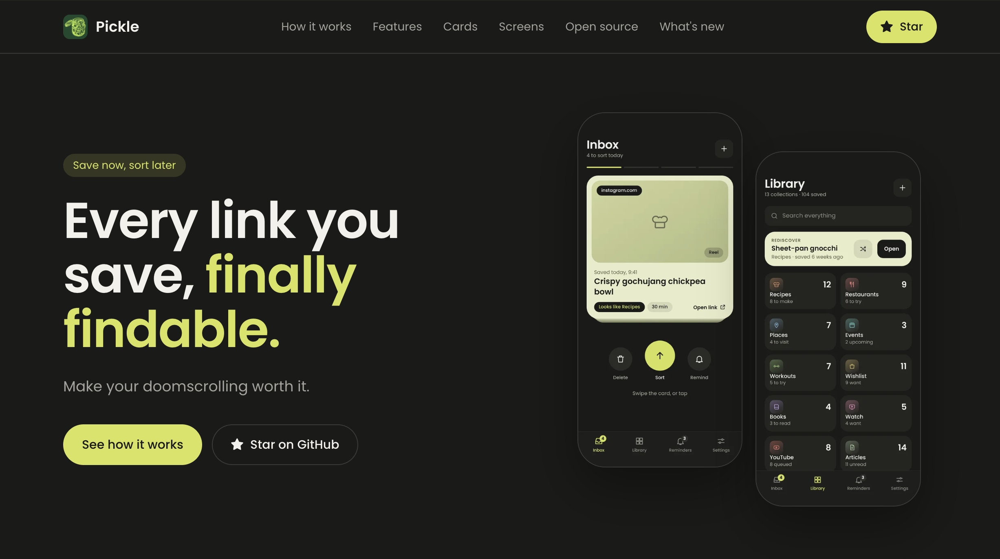
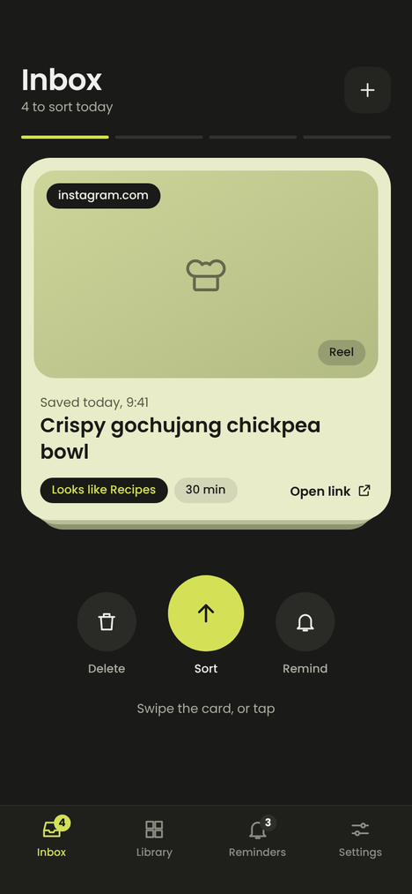
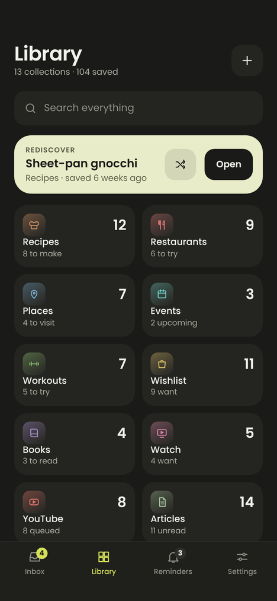
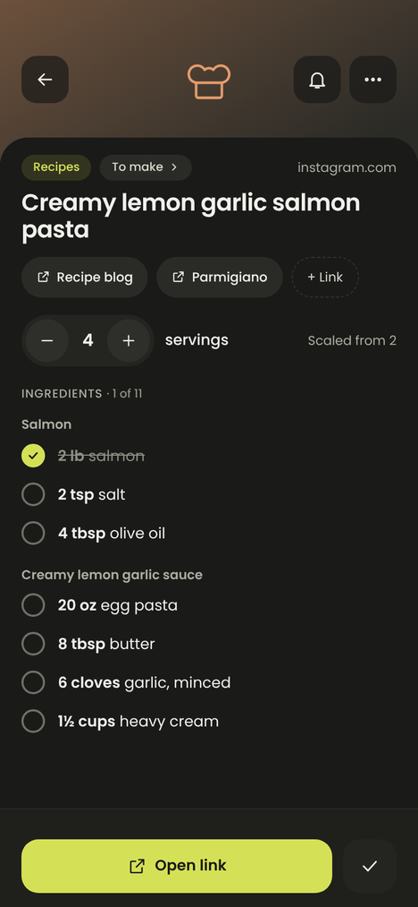
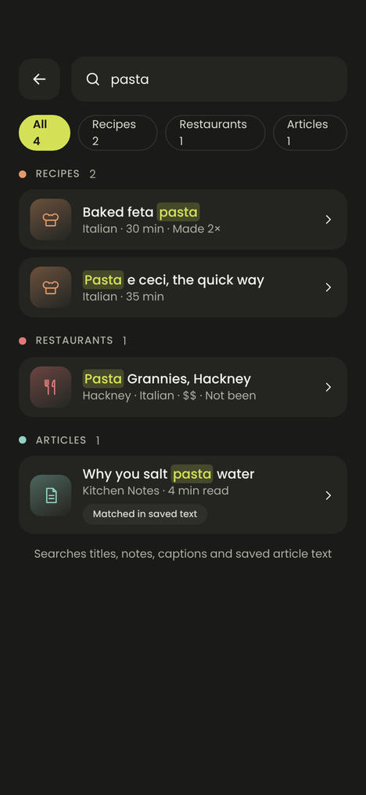
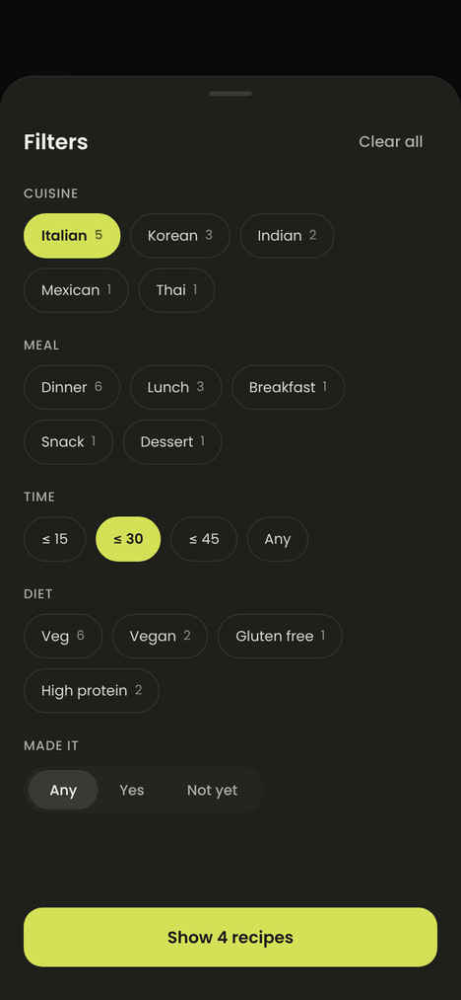
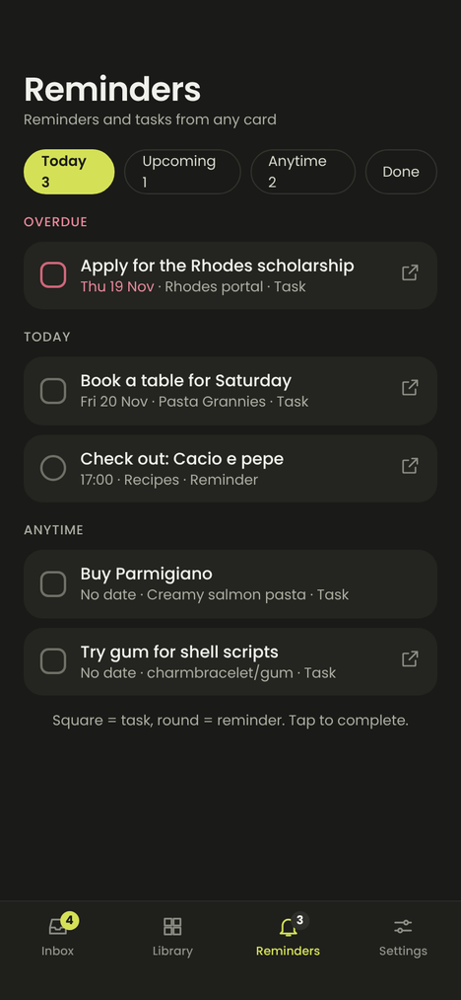
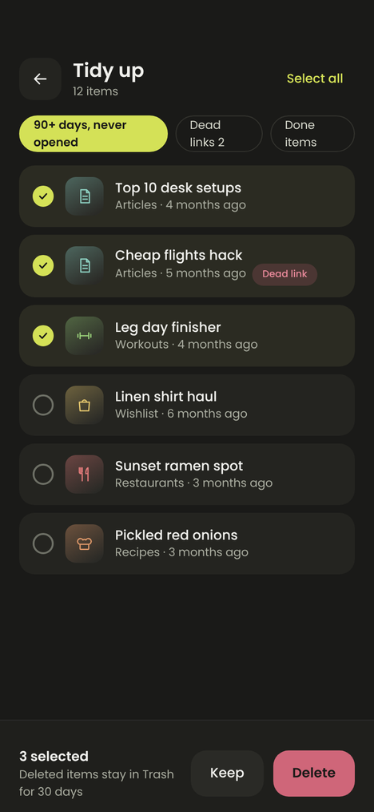
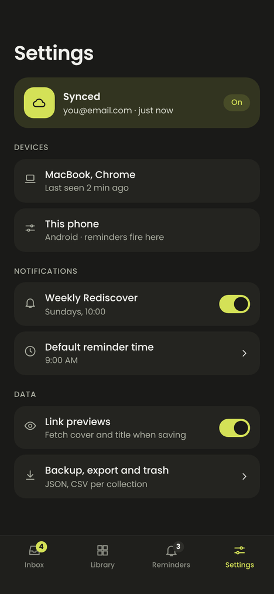

  

<h3 align="center">A calm place for the links you save</h3>

  Share a recipe reel, a restaurant, a hackathon or a book. Pickle turns it into a tidy card, 
  holds it in your inbox, and files it in the right collection in one tap.

  
  
  
  
  
  

  <a href="https://keethapps.github.io/pickle/"><b>Website</b></a> ·
  <a href="#features">Features</a> ·
  <a href="#the-cards">Cards</a> ·
  <a href="#how-it-works">How it works</a> ·
  <a href="#status">Status</a> ·
  <a href="#privacy-and-your-data">Privacy</a> ·
  <a href="#contributing">Contributing</a> ·
  <a href="#support">Support</a>

---

  
  
  
  

  
  
  
  

<b>Inbox</b> · <b>Library</b> · <b>Details</b> · <b>Search</b> · <b>Filters</b> · <b>Reminders</b> · <b>Tidy up</b> · <b>Settings</b>

---

## Overview

Most of us save links everywhere: screenshots, chats, bookmarks, "saved" tabs we never open again. Pickle gives them one home.

You share a link to Pickle. It saves instantly to your **inbox**. When you have a minute, you sort it into a **collection** such as Recipes, Places or Books. Each collection knows what matters for that kind of thing, so a recipe shows cuisine and cook time, and a restaurant you want to try shows you what you should order when you're there.

If you like Pickle, a ⭐ on this repo helps more people find it.

---

## Features

<table>
<tr>
<td valign="top" width="50%">

### Save and sort
- **Share to save** from any app, or paste a link
- **Inbox** of big swipeable cards: up to sort, left to delete, right to remind
- **Duplicate check**: already saved? Pickle tells you instead of adding it twice
- **Smart suggestions**: "looks like Recipes" from the caption
- **Undo** for deletes, and **Trash** that keeps items for 30 days
- **Inbox zero** you can actually reach

</td>
<td valign="top" width="50%">

### Collections
- **13 ready-made collections**: Recipes, Restaurants, Places, Workouts, Wishlist, Books, Watch, YouTube, Articles, Opportunities, Tools, Events and Design Inspo
- **Per-collection fields and filters**, so each kind of card shows what matters
- **Collection builder** for your own, with custom fields
- **Editable statuses**: rename, recolor, add and reorder
- **Extra links** on any card, each with its own label

</td>
</tr>
<tr>
<td valign="top">

### Find things again
- **Search everything**: titles, captions and saved article text
- **Filter sheets** that change per collection (cuisine, time, diet, price, deadline and more)
- **Rediscover** surfaces something you saved and forgot
- **Library** overview with counts per collection

</td>
<td valign="top">

### Reminders and tasks
- **Remind me** on any card, prefilled from deadlines Pickle finds
- **Tasks** with a due date that open the link when due
- **One list**: today, upcoming, anytime and done
- **Notify your laptop** too

</td>
</tr>
<tr>
<td valign="top">

### Inside a card
- **Recipes**: ingredient checklist with scalable servings
- **Workouts**: exercises with sets and reps
- **Places and restaurants**: one-tap Maps, notes and booking links
- **Articles**: reader view with an offline copy, kept even if the link dies

</td>
<td valign="top">

### Tidy and sync
- **Tidy up** surfaces old saves for a bulk keep or delete
- **Muted when done**: finished things stay out of the way
- **Sync** across your phone and laptop
- **Keyboard-first laptop layout**: arrows to sort, `o` to open, `e` to edit

</td>
</tr>
</table>

---

## The cards

Every card has the same shape, so your library feels calm. What changes is what it shows and what its main action does.

| Collection | On the card | Main action |
|---|---|---|
| **Recipes** | Cuisine and time, diet pills, made-it count | Open recipe, +1 made it |
| **Restaurants** | Area, cuisine, price, dish to try | Open in Maps, mark been |
| **Places** | City and type, trip tag | Open in Maps, mark visited |
| **Workouts** | Muscle group, duration, equipment, level | Start, +1 done |
| **Wishlist** | Price, priority, who it is for | Open store, mark bought |
| **Books** | Author, pages, genre | Open link, mark finished |
| **Watch** | Year, type, runtime, streaming service | Open link, mark watched |
| **YouTube** | Channel, duration, start-at note | Watch, mark watched |
| **Articles** | Publication, read time, offline badge | Read, mark read |
| **Opportunities** | Deadline countdown (turns red when overdue) | Open link, remind |
| **Tools** | Kind, language, use-for note | Open repo, mark using |
| **Events** | City, type, date badge | Open in Maps, went or skipped |
| **Design Inspo** | Your screenshot as the cover | Open source, keep |

**Every card:** source top left, one badge top right, a title, one subtitle, up to two pills and one primary action. Anything else lives in the detail screen.

---

## How it works

1. **Share a link.** Send anything to Pickle. It saves instantly and fetches the title and cover.
2. **Sort it.** Swipe up to file it into a collection, add a few details, or skip them for later.
3. **Find it again.** Search across everything or filter a collection.

---

## Status

Pickle is under active development.

<!-- EDIT: update this table to match what you actually support -->
| Platform | Status |
|----------|--------|
| Phone app | 🚧 In progress |
| Laptop | 🚧 In progress |
| Browser extension | 📅 Planned |

Follow along with **Watch → Custom → Releases**, or ⭐ star the repo to keep it on your radar. See [CHANGELOG.md](CHANGELOG.md) for what has shipped and [Releases](https://github.com/keethapps/pickle/releases) for each version.

---

## Privacy and your data

Your library belongs to you.

- **Export everything** as JSON, or import it back, any time.
- **Automatic backups** to a folder you choose.
- **Deleted items** stay in Trash for 30 days, then go for good.
- **Link previews** can be turned off in Settings if you would rather not fetch covers and titles.

<!-- EDIT: add your own promise here only if it is true, e.g. "no ads, no tracking" -->

---

## Contributing

Bug reports, ideas and pull requests are all welcome. Start with [CONTRIBUTING.md](CONTRIBUTING.md). For anything bigger than a fix, please open an issue first so we can agree on the direction. Everyone taking part is expected to follow the [Code of Conduct](CODE_OF_CONDUCT.md).

Maintainers: see [RELEASING.md](RELEASING.md) and [SETUP.md](SETUP.md).

Found a security problem? See [SECURITY.md](SECURITY.md).

---

## Contact

Questions that do not fit in an issue: **getafterword@gmail.com**

---

## Support

Pickle is free and open source.

If you want to give something back, a ⭐ star, a clear bug report or a share with a friend help as much as anything else.

<!-- EDIT: add Ko-fi / GitHub Sponsors here if you want, e.g.

-->

Released under the [MIT License](LICENSE). Made by [Keerthana Vegesna](https://github.com/keethapps).
